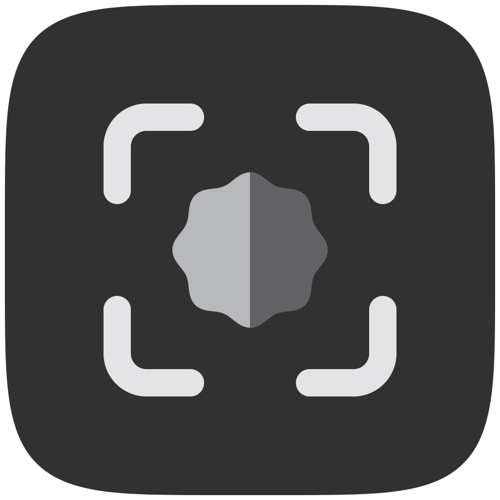

<div align="center">

<h1>Celestite</h1>
<p>A native, zero-bloat, fully offline screen recorder for Android. Built with Jetpack Compose and Material 3 Expressive</p>
<p>No internet permission at all. Optimized hardware encoding for lower-end devices, with dynamic color (Material You) theming.</p>
</div>
<p align="center">
  <a href="https://github.com/rynekryz/celestite/stargazers"></a>
  <a href="https://github.com/rynekryz/celestite/tags"></a>
  <a href="LICENSE"></a>
  
  
</p>

> **Status:** Early beta. Expect bugs and breaking changes between versions. See [Releases](https://github.com/rynekryz/celestite/releases) for the latest APK.

---

## Features

### Beautiful Design
- **Material 3 Expressive:** Leveraging the latest Material 3 components for a bold and modern look.
- **Dynamic Color (Material You):** Themes that adapt to your wallpaper (Android 12+).
- **Quick Settings Tile:** A record launcher right in the QS panel, using the app icon without background.

### Recording
- **Screen Capture:** Hardware-backed `MediaProjection` recording with a foreground service.
- **Audio Sources:** None, microphone, or device audio (internal playback capture).
- **Codec Choice:** H.264 everywhere, or H.265/HEVC for smaller files on newer devices.
- **Resolution Control:** Native, 1080p, or 720p fallback profiles for lower-end hardware.
- **Frame Rate:** Auto (up to your display refresh rate), 60, or 30 fps.
- **Quality Profiles:** Auto, high, medium, and low bitrate presets.
- **Countdown:** Optional 3, 5, or 10 second countdown before capture starts.
- **Pause & Resume:** Available on mic / no-audio recordings.
- **Floating Controls:** Optional draggable pause/stop pill, off by default. Android does not let a normal app hide its overlay from its own capture, so when enabled it shows as a black box in the video; the notification and QS tile are the default controls.
- **Low-End Friendly:** Optimized encoder profiles that keep performance smooth.

### Gallery & Tools
- **Recordings List:** All your recordings from `Movies/Celestite` in one place.
- **Fullscreen Player:** Letterboxed playback with floating, auto-hiding controls and a seekbar.
- **Simple Trimmer:** Cut recordings down to a selection and save as a copy.
- **Share & Delete:** Handled through Scoped Storage and the MediaStore API.

### Privacy
- **100% Offline:** Zero network access, no tracking, no ads.
- **Local-Only:** Every recording stays on your device.

---

## Technical Stack

- **UI:** Jetpack Compose with Material 3 Expressive
- **Architecture:** Multi-module (app, core, feature, service)
- **Capture:** MediaProjection + MediaRecorder / MediaCodec
- **Data Persistence:** Jetpack DataStore (Preferences)
- **Storage:** Scoped Storage via MediaStore
- **Language:** 100% Kotlin
- **Build System:** Gradle (Kotlin DSL)

---

## Getting Started

### Prerequisites
- Android Studio (latest stable)
- JDK 21
- Android SDK 37 (compile target)
- Minimum SDK: Android 12 (API 31)

### Build
1. Clone the repository.
2. Open the project in Android Studio.
3. Sync Gradle and run the `:app` module.

```bash
# Build debug APK (all ABIs + universal)
./gradlew assembleDebug
```

---

## Project Structure

```
Celestite/
├── app/                    # Application entry point, MainActivity, licenses
├── core/
│   ├── model/              # Shared data classes (RecordingState, settings)
│   ├── datastore/          # Preferences DataStore for app settings
│   └── designsystem/       # Material 3 Expressive themes and reusable atoms
├── feature/
│   ├── recorder/           # Main dashboard, record modal, countdown
│   ├── gallery/            # Video list, player, and simple trimmer
│   └── settings/           # App configuration and permission handlers
└── service/                # Foreground service handling MediaProjection
```

---

## License

Distributed under the GNU General Public License v3.0 (GPLv3). See [LICENSE](LICENSE) for more information.

---

## Contributing

Contributions are welcome! Feel free to open [issues](https://github.com/rynekryz/celestite/issues) or submit pull requests.

<div align="center">
<strong>Made with ♥︎ by Ryne</strong>
</div>
<div align="center">
  <a href="https://discord.gg/YKhWXXhKmC"></a>
  <a href="https://tiktok.com/@rynekryz"></a>
</div>
